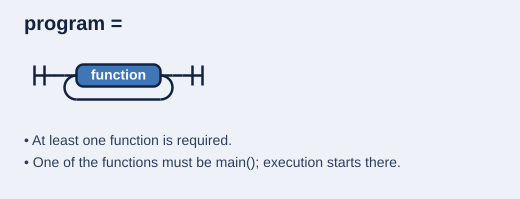
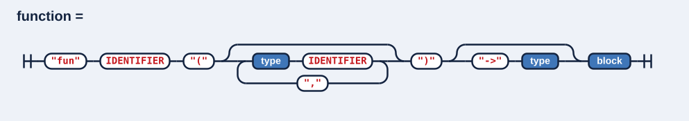
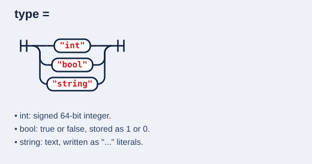

# compiler - WIP

A compiler for a small, statically typed, C-like language, written from scratch in C++20.
It reads a source file, tokenizes and parses it into an AST, and generates x86-64 assembly
for Linux (NASM), which is then assembled and linked into a native executable.

```kotlin
fun add(int a, int b) -> int {
    def x = a + b;
    ret x;
}

fun main() -> int {
    ret add(2, 3);   // exit code 5
}
```

## Origin

The project started by following Pixeled's YouTube series
[*Creating a Compiler*](TODO-playlist-link) (the "Hydrogen" language, reference code:
[orosmatthew/hydrogen-cpp](https://github.com/orosmatthew/hydrogen-cpp)).
The tutorial version is preserved at the `finish-hydro` tag.

From there the syntax and the node structure were redesigned,
and the compiler was extended well beyond the series with:

- functions with parameters, return types and calls, using the System V calling convention
- `ret` as a real return statement
- `while` loops
- the full set of arithmetic operators with correct precedence, plus unary `-` and `!`
- comparison operators and `bool` literals
- typed and inferred variable declarations (`def int x = 1;` / `def x = 1;`)
- source locations (line and column) in every error message

## Language reference

The full grammar is in [`docs/grammer.ebnf`](docs/grammer.ebnf).

- [Program](#program)
- [Function](#function)
- [Type](#type)
- Block
- Statement
  - Def
  - Assign
  - Ret
  - If / Elif / Else
  - While
  - Call statement
- Expression
  - Operators and precedence
  - Literals
- Comments

### Program



A program is a list of one or more functions, and nothing else: no statements or
variables at the top level. Execution starts at `main`, and its return value becomes
the process's exit code. A program without a `main` function is rejected.

### Function



```kotlin
fun add(int a, int b) -> int {
    ret a + b;
}

fun reset() {          // no return type
    ret;
}
```

- **Name:** any identifier. Functions may be called before they are defined.
- **Parameters:** zero or more, each written as a type followed by a name and separated by commas.
  Parameters are passed in registers, so a function can have at most 6.
- **Return type:** optional, written after `->`. A function with a return type returns a
  value with `ret expr;`. A function without one uses a bare `ret;` or simply reaches its closing `}`.
- **Body:** a block. Parameters behave like local variables declared at the top of it.

### Type



```kotlin
def int count = 10;
def bool done = false;
def total = count * 2;      // type inferred from the value: int

fun isPositive(int n) -> bool {
    ret n > 0;
}
```

- **`int`:** a signed 64-bit integer, from −9,223,372,036,854,775,808 to 9,223,372,036,854,775,807.
  Arithmetic wraps around on overflow, and division truncates toward zero.
- **`bool`:** `true` or `false`, stored as 1 and 0. Comparisons (`<`, `==`, …) and logical
  operators (`&&`, `||`, `!`) produce a `bool`.
- **`string`:** text, written as a literal in double quotes (`"hello"`).
- **Where types appear:** before a parameter name, after `->` as a function's return type,
  and optionally after `def`. With `def x = value;` the type is taken from the value.
- **Conditions:** `if` and `while` accept any expression. Zero counts as false,
  anything else as true.
